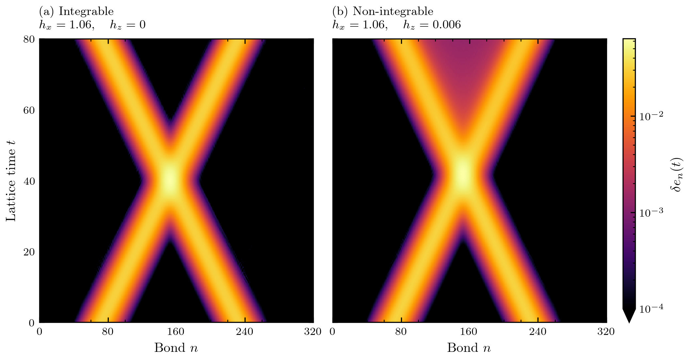
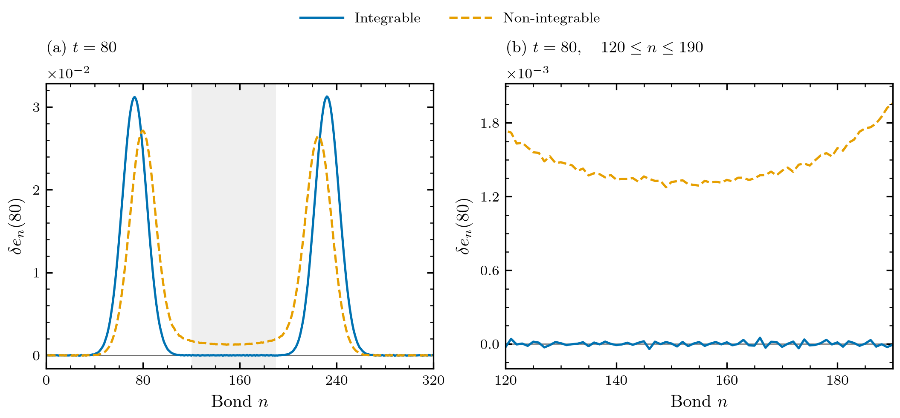
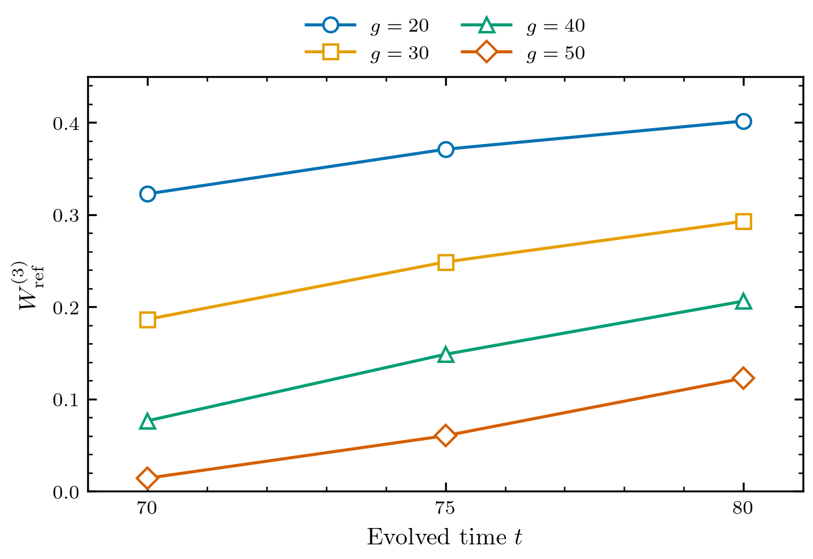
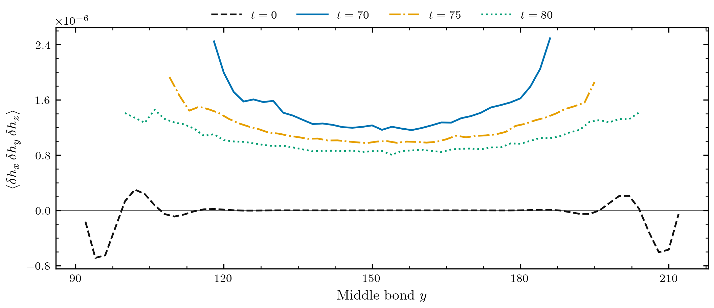
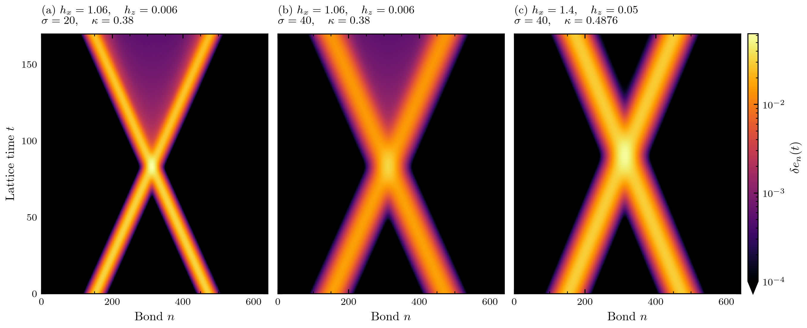
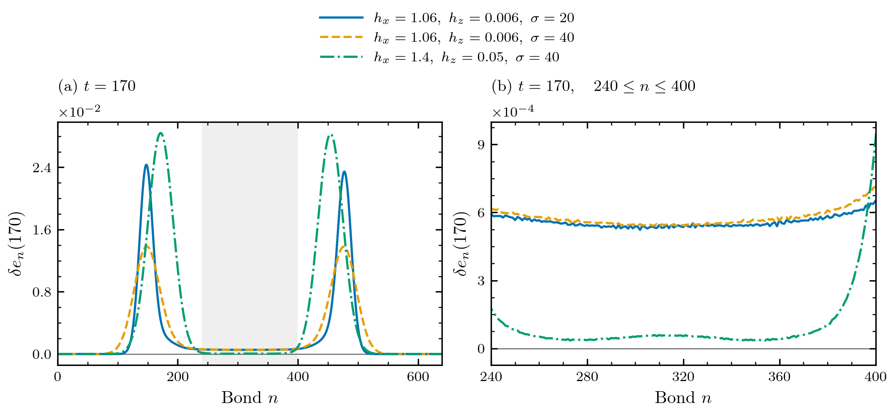

# IFT

We compare collisions of two Ising particles at an integrable point and
away from it, then examine how the outgoing energy changes with broader
packets and different couplings. The first comparison uses 320 sites and
evolves to ``t=80``. The [longer evolutions](#Broader-packets-and-longer-evolution)
use 640 sites and reach ``t=170``. Energy slices at these final times show
the smaller energy density between the two main outgoing peaks.

The Hamiltonian is

```math
H=-\sum_n\left(\sigma_n^z\sigma_{n+1}^z
 +h_x\,\sigma_n^x+h_z\,\sigma_n^z\right),
\qquad J=a=\hbar=1\,.
```

The [Ising scattering paper](https://arxiv.org/abs/2411.13645) describes the
MPS packet construction and outgoing-state projections used here. The
[Ising theory page](../physics/ising.md) introduces the lattice model and
its relation to the field theory.

## Integrable and non-integrable collisions



We plot the difference ``\delta e_n(t)`` between the bond energy and its
value in the vacuum. Panel (a) shows the integrable chain with
``h_x=1.06,\ h_z=0`` and panel (b) the non-integrable chain with
``h_x=1.06,\ h_z=0.006``. Both calculations use 320 sites, packet centres at
80 and 240, central momenta ``\pm0.38``, and Gaussian amplitude width
``\sigma=20``. The vacuum bond dimension is 8, the maximum evolution bond
dimension is 24, and the time step is ``\Delta t=0.1``, with evolution up to
``t=80``. We use ``J=a=\hbar=1``. The two panels share a logarithmic colour
scale, with values below ``10^{-4}`` shown in black. Neither energy density
is rescaled.
The [PDF figure](../assets/ising-collision/energy-comparison.pdf) is also available.

In the integrable run, the packets meet near ``t=40`` and separate into
two outgoing bands. In the non-integrable run, they meet near ``t=42``.
Two bright bands move away from the collision, with a weaker spread of
energy between them. We use the same colour limits in both panels, so
this difference comes from the measured energy densities.

At ``h_z=0``, we can map the spin chain to free fermions. Their momentum-mode
occupations are conserved, so a state of two incoming quasiparticles remains
in the two-particle sector. Turning on ``h_z`` introduces interactions that
allow the outgoing particle content to change. The free-fermion mapping is given in
[Appendix A of the paper](https://arxiv.org/html/2411.13645v1#A1).

The finite window has a uniform MPS vacuum extending to infinity on each
side. We calculate the vacuum and excitation tensors separately for each
Hamiltonian before preparing the packets. The Gaussian amplitudes are
proportional to
``\exp[-(n-n_0)^2/\sigma^2]``. Here ``\sigma=20`` is the width parameter of
the amplitude, not the standard deviation of its squared magnitude. The
vacuum MPS correlation lengths are about 12.95 sites in (a) and 6.79 sites
in (b). Full MPS states are saved at ``t=0,5,10,\ldots,80`` in both runs.

### Energy at ``t=80``



The solid blue curve is the integrable run with ``h_x=1.06,\ h_z=0``;
the dashed orange curve is the non-integrable run with
``h_x=1.06,\ h_z=0.006``. We take both slices at ``t=80``, using the same
320-site runs as in the heatmap. Their other parameters are
``\sigma=20``, ``\kappa=0.38``, vacuum bond dimension 8, maximum evolution
bond dimension 24, and ``\Delta t=0.1``. Panel (a) includes all 319 internal
bonds. The shaded interval, ``120\le n\le190``, is enlarged in panel (b),
where the vertical scale is smaller. Both axes are linear, and the curves
retain the signed energy values, including values below ``10^{-4}``.
The non-integrable curve stays above zero across this interval, while the
integrable curve has small oscillations around zero. You can download the
[PDF](../assets/ising-collision/energy-slice.pdf) and the
[values at every bond](../assets/ising-collision/energy-slice.csv).

At ``t=80``, bonds 120 through 190 contain about ``0.0068\%`` of the summed
excess energy in the integrable run, compared with ``6.35\%`` in the
non-integrable run. We obtain these fractions by summing the signed
``\delta e_n`` over those bonds and dividing by its sum over all 319
internal bonds. The energy between the peaks is much smaller than the peak
heights, but it extends over many bonds and contributes appreciably to the
total in the non-integrable run.

Some bonds have ``\delta e_n<0``. The vacuum minimizes the total energy;
it need not minimize each bond term separately. A bond can therefore have
an expectation value below its value in the vacuum while the total energy
remains above the vacuum energy. These negative values are included in the
slice and the [signed heatmap](../assets/ising-collision/energy-signed.pdf).

The signed plot also makes faint oscillations around zero visible. Such
oscillations are present before the collision in both runs, with values of
order ``10^{-5}``. Comparing them at larger bond dimensions and smaller
time steps would help separate coherent oscillations from numerical errors.

## The particle masses

For the ``h_x=1.06,\ h_z=0.006`` collision above, the incoming central energy is
``2E_1(0.38)\simeq1.6380``. To identify which species can appear after the
collision, we repeat the uniform-vacuum
and excitation calculations at larger bond dimensions ``D``.
The table gives the two lowest rest energies above each vacuum.

| ``D`` | ``m_1`` | ``m_2`` | ``2m_1-m_2`` |
| --- | --- | --- | --- |
| 16 | 0.254846 | 0.505977 | 0.003715 |
| 24 | 0.254845 | 0.500243 | 0.009448 |
| 32 | 0.254845 | 0.499486 | 0.010205 |
| 48 | 0.254845 | 0.498518 | 0.011173 |
| 64 | 0.254845 | 0.498326 | 0.011365 |

The heavier state lies below the rest energy of two light particles. It
therefore cannot decay into two of them while conserving energy and
momentum. Its mass changes by ``0.000192`` between ``D=48`` and ``D=64``,
or about ``0.04\%``. The same change is about ``1.7\%`` of the binding
energy ``2m_1-m_2``, so the binding energy is more sensitive to ``D`` than
the mass.

The two-species spectrum agrees with the regime described in
[Appendix A of the paper](https://arxiv.org/html/2411.13645v1#A1).
The available energy permits channels such as ``11\to12``, ``11\to22``,
and ``11\to111``. The first two create heavier particles while retaining
two outgoing particles; the last increases their number. Conservation of
energy and momentum restricts their momenta, but does not fix their
probabilities.

These larger-``D`` vacua belong to the spectrum calculation. The collision
above still uses its ``D=8`` vacuum. The light-particle energy at incoming
momentum changes by only about ``0.004\%`` from ``D=8`` to ``D=64``, while
the heavier state needs the larger variational space to fall below the
two-light-particle threshold. Projecting the saved collision onto that
heavier species requires an excitation construction compatible with its
vacuum and boundary tensors.

## Overlaps after the collision

For the 320-site non-integrable run, the two-light-particle calculation
includes the momentum dependence of the excitation tensors. At ``t=80``,
its outgoing weight is ``0.259713`` with
at least 80 sites between the two insertions. The same calculation recovers
``0.998331`` of the incoming state; dividing by that incoming value gives
``0.260147``. Reducing the final-state separation to 60 sites changes this
ratio to ``0.260182``.

There is also a substantial overlap with states containing three ordered
light-particle insertions. For this calculation the excitation tensors are
held at reference momenta ``(-\pi/10,0,+\pi/10)``. Their excitation energies
sum to ``1.6411``, close to the incoming central energy. The insertion
positions vary across the window, with both neighbouring distances at
least ``g``. The weight is

```math
W_{\rm ref}^{(3)}(t;g)=
\frac{\sum_{n,r}b_{n,r}^{\dagger}G_{r-n}^{+}b_{n,r}}
{\langle\psi(t)|\psi(t)\rangle},
```

where ``b_{n,r}`` contains the overlaps at the allowed middle positions,
and ``G_{r-n}`` is their Gram matrix. The need for this matrix is explained
on the [projection page](../physics/particle-production.md).



Each curve uses a different minimum distance ``g`` between neighbouring
insertions. The plotted points are the saved states at ``t=70,75,80``;
the lines join those measurements. At ``g=40``, the weight grows from
``5.64\times10^{-6}`` in the initial state to ``0.20626`` at ``t=80``.
At the final time it ranges from ``0.40158`` for ``g=20`` to ``0.12268``
for ``g=50``.

This growth, together with the momentum support near zero total momentum,
provides evidence for an outgoing three-particle component. At ``t=80``
and ``g=40``, ``96.65\%`` of the weight on the selected Fourier grid has
``|p_1+p_2+p_3|<0.15``. Its total-momentum standard deviation is ``0.0697``,
close to the incoming Gaussian estimate ``\sqrt{2}/\sigma=0.0707``.
As a separate check, we project localized outgoing light-particle pairs
onto the same triple references. Across the tested
outer separations, their largest weight is ``1.58\times10^{-6}`` at
``g=40``. This checks contamination from those chosen pairs; it does not
bound contamination from every possible two-particle state.

Here we vary the three insertion positions while holding their excitation
tensors at the reference momenta. To obtain the full ``111`` probability,
we also need the momentum dependence of all three tensors and must distinguish
their contribution from the other outgoing channels. The curves still change
with time and with the minimum separation ``g``. Increasing ``g`` removes
configurations in which two insertions are close together. This includes
outgoing particles with similar velocities, which take longer to separate.
We therefore need to compare these weights at later times before assigning
a final three-particle probability.

## Energy correlations

The saved MPS also allows a comparison of energy at three separated bonds.
With ``\delta h_n=h_{n,n+1}-\langle h_{n,n+1}\rangle_{\rm vac}I``, the
following figure shows ``\langle\delta h_x\delta h_y\delta h_z\rangle``.
The outer bonds ``x,z`` are placed at the two energy peaks at each time,
and the middle bond ``y`` is varied between them. The outer pairs are
``(72,232)``, ``(98,206)``, ``(89,216)``, and ``(80,225)`` at
``t=0,70,75,80``, respectively.



The initial curve is close to zero in the middle of the window. After the
collision, the three-point expectation is positive throughout that region.
For example, at ``t=80`` and bonds ``(80,160,225)``, it is
``8.78\times10^{-7}``; the vacuum value is below ``5\times10^{-18}`` in
magnitude. Subtracting the products of one- and two-point expectations
gives a connected third cumulant of ``1.05\times10^{-8}``. These
correlations compare energy in the outer and interior regions together.

## Broader packets and longer evolution

We also evolve three non-integrable collisions in a window of 640 sites.
In the first two runs, we keep the couplings and central momenta fixed and
change the Gaussian width from ``\sigma=20`` to ``\sigma=40``. The broader
packet has a narrower momentum distribution. For the Gaussian envelope,
the momentum standard deviation is approximately ``\Delta p=1/\sigma``.
In the third run, we change the couplings and choose
the incoming central energy to be ``2E_1(\kappa)\simeq3.15m_1``, where
``m_1`` is the lightest particle's rest energy calculated with the same vacuum.
These couplings and this energy are used in the lower row of Fig. 4 of
[Jha et al.](https://arxiv.org/html/2411.13645v1#S3).



We plot ``\delta e_n(t)``, the bond energy minus its value in the vacuum.
In (a), ``h_x=1.06``, ``h_z=0.006``, ``\sigma=20``, and the incoming
momenta are centred at ``\pm0.38``. In (b), the fields and central momenta
are unchanged, with ``\sigma=40``. In (c), ``h_x=1.4``, ``h_z=0.05``,
``\sigma=40``, and ``\kappa=0.4875922799``. The first two runs have
``2E_1(\kappa)/m_1\simeq6.42``, compared with ``3.15`` in (c).
All three start with packet centres at sites 160 and 480, a vacuum bond
dimension of 8, and a maximum evolution bond dimension of 48. We use
``\Delta t=0.1`` and evolve to ``t=170``, saving an MPS every 5 units of
lattice time. The units are ``J=a=\hbar=1``. The three panels share an
inferno colour scale from ``10^{-4}`` to ``0.06277``; values below the
lower limit appear black. Each panel contains the measured energies on
all 639 internal bonds. The [PDF](../assets/ising-collision/longer-evolution/energy-comparison.pdf)
is also available.

The incoming group velocities give meeting times of approximately ``t=83``
in (a) and (b), and ``t=90`` in (c), leaving about 80–87 units of lattice
time after the collision. Broadening the packets widens both the incoming
bands and the region where they overlap. After the main outgoing bands
separate, positive energy remains between them in both (a) and (b).
Much of the central energy in (c) falls below the colour scale's lower
limit. We can examine it directly in a slice at fixed time.

### Energy at ``t=170``



We compare the final energy profiles for the three runs in the heatmap.
The solid blue and dashed orange curves have ``h_x=1.06,\ h_z=0.006``
and widths ``\sigma=20`` and ``40``, respectively. The dash-dotted green
curve has ``h_x=1.4,\ h_z=0.05,\ \sigma=40``. Their momenta, MPS bond
dimensions, and time step are those given above. Panel (a) shows the full
window at ``t=170``. Panel (b) enlarges the shaded interval
``240\le n\le400``, using a smaller vertical scale. Both panels retain
every signed energy value in their displayed interval. The curves join
the values at neighbouring bonds without smoothing or a colour cutoff.
The [PDF](../assets/ising-collision/longer-evolution/energy-slice.pdf) and
[slice data](../assets/ising-collision/longer-evolution/energy-slice.csv)
are available for download.

At ``t=170``, the blue and orange curves have their main peaks near bonds
148 and 476–477. Between those peaks, both curves remain positive. In the
enlarged interval their values are roughly ``5\times10^{-4}`` to
``7\times10^{-4}``, despite the difference in packet width. Broadening
the incoming packets has therefore left a similar central energy density
in these two runs.

The green curve has much less energy near the centre. At bond 320 its
value is ``5.43\times10^{-5}``, about half the heatmap's lower colour
limit. This is why the centre of that heatmap appears black. The linear
slice includes these smaller values and shows how the energy varies
across the interval.

We can also compare the energy contained in this interval by summing its
bond energies and dividing by the sum over the whole window,

```math
f_{240:400}(170)=
\frac{\sum_{n=240}^{400}\delta e_n(170)}
     {\sum_{n=1}^{639}\delta e_n(170)}\,.
```

| Run in the heatmap | Energy in bonds 240–400 as a fraction of the total |
| --- | --- |
| (a) ``h_x=1.06,\ h_z=0.006,\ \sigma=20`` | ``5.48\%`` |
| (b) ``h_x=1.06,\ h_z=0.006,\ \sigma=40`` | ``5.66\%`` |
| (c) ``h_x=1.4,\ h_z=0.05,\ \sigma=40`` | ``0.518\%`` |

The similar fractions in (a) and (b) put a number on the agreement between
their central energy profiles. In (c), we have changed both the couplings
and the incoming energy in units of ``m_1``, so the smaller fraction
compares a different scattering process.

### The outgoing particles

The broad central energy raises the question of which particles carry it.
An energy-density plot combines the possible outcomes in the outgoing
quantum state. For a three-particle outcome, specifying the total energy
and momentum still leaves a continuous range of ways to share momentum
among the particles. Those different momenta give different velocities.
Their contributions to the energy expectation value can therefore fill
a broad region between the outer tracks. Newly produced particles need
not each appear as a separate narrow line. This interpretation of the
three-particle contribution is explained in
[Section III of the paper](https://arxiv.org/html/2411.13645v1#S3).

For the 320-site run, the overlaps and energy correlations above give
additional information about the outgoing state. For the three 640-site
runs, we have so far examined the local energy and spin expectation values.
The next calculation is to take overlaps of their saved MPS states with
states containing specified outgoing particles, at several late times.
We can also calculate three-point energy correlations with two positions
held near the outer peaks and the third varied across the centre. Together,
these calculations address which particles are present and which outgoing
regions carry energy together. The overlap construction is explained on
the [particle-production page](../physics/particle-production.md).

The percentages in the table are fractions of energy in a chosen spatial
interval. An outgoing-channel probability instead comes from the overlap
with states in that channel. Comparing those overlaps at several late
times will also tell us whether the particles have separated enough for
the inferred probabilities to stop changing. If they need more time, we
can enlarge the window by adding vacuum outside the incoming packets and
evolve longer after the collision, keeping their initial separation fixed.

### Signed energy and spin

The [signed-energy figure](../assets/ising-collision/longer-evolution/energy-signed-comparison.png)
shows the same three runs in the same order, with positive values in red,
negative values in blue, and zero in white. Its colour scale is linear
between ``-10^{-4}`` and ``10^{-4}``, and logarithmic outside that interval;
the limits are ``\pm0.06277`` in every panel. The most negative bond
energies over the full evolution are ``-4.40\times10^{-5}``,
``-1.64\times10^{-5}``, and ``-1.31\times10^{-5}`` in (a), (b), and (c).
A [PDF copy](../assets/ising-collision/longer-evolution/energy-signed-comparison.pdf)
is available.

The [spin figure](../assets/ising-collision/longer-evolution/spin-comparison.png)
plots ``\delta\langle\sigma_n^z(t)\rangle
=\langle\sigma_n^z\rangle_t-\langle\sigma^z\rangle_{\rm vac}``
on all 640 sites, for the same parameters and times. Blue shows a decrease
from the vacuum magnetization and red an increase. All three panels use
the same linear colour scale, with limits ``\pm0.68843``. The spin change
is smaller in (c), so its tracks appear fainter on this shared scale.
The [PDF](../assets/ising-collision/longer-evolution/spin-comparison.pdf)
is also available.

Over the evolution to ``t=170``, the summed bond energy decreases by
``0.245\%``, ``0.0749\%``, and ``0.0284\%`` in (a), (b), and (c).
The final squared norms are ``0.997625``, ``0.997274``, and ``0.999771``.
The local expectation values already include division by the state's
squared norm. To check the effect of the MPS approximation, we can repeat
a run with larger vacuum and evolution bond dimensions and compare the
energy profiles at the same times. A separate repetition with a smaller
time step checks the time evolution. Keeping the physical parameters
fixed in these comparisons lets us see how much the central energy and
outgoing overlaps change with each numerical choice. The colour limits
and the recorded energy and norm changes are given in the
[figure settings](../assets/ising-collision/longer-evolution/energy-comparison.json).

## Running the calculation

After [installing the Julia environment](../running.md), you can run the
320-site non-integrable collision from the repository directory with

```sh
julia --project=simulations simulations/models/ift/scripts/collide_fixed_momentum.jl \
  --bond_dimension 8 --evolution_bond_dimension 24 \
  --length 320 --n_center 80 --kappa 0.38 --sigma 20 \
  --h_x 1.06 --h_z 0.006 --time_step 0.1 --total_time 801 \
  --save_every 50 --output_dir results/ift/collision-320
```

This command uses the non-integrable parameters in panel (b). For panel
(a), change `--h_z 0.006` to `--h_z 0` and use
`--output_dir results/ift/integrable-320` to keep the two runs separate.

`--total_time 801` counts the initial row and 800 evolution steps, giving
``t_{\rm final}=80``. The saved states are in a new subdirectory under
`results/ift/collision-320/states/`. Both runs shown here used Julia 1.12.6,
two Julia threads, one BLAS thread, and random seed 20260924. Each took about
two hours on the machine used for this example. Compilation, processor,
memory, and package versions affect that time. The command above uses a
new random initialization. The settings files for
[panel (a)](../assets/ising-collision/integrable-run-settings.toml) and
[panel (b)](../assets/ising-collision/run-settings.toml) record the parameters
of the displayed runs.

The mass comparison can be repeated separately with

```sh
julia --project=simulations simulations/models/ift/scripts/bound_state_spectrum.jl \
  --gx 1.06 --gz 0.006 --bond-dimensions 16 24 32 48 64 \
  --rest-only --output-dir results/ift/spectra
```

To calculate a three-reference weight, start Julia with
`julia --project=simulations` from the repository directory. Set
`state_path` to one of your saved MPS files, then run

```julia
using LinearAlgebra, MPSKit, TensorKit
scripts = "simulations/models/ift/scripts"
include(joinpath(scripts, "state_io.jl"))
include(joinpath(scripts, "particle_basis.jl"))
include(joinpath(scripts, "three_particle_overlap.jl"))
using .IFTStateIO, .IFTParticleBasis, .IFTThreeParticleOverlap

saved = load_ift_state(state_path)
psi = saved["state"]
vac = saved["reference"]["vacuum"]
ham = saved["reference"]["hamiltonian"]
arrays = vacuum_arrays(vac)
particle_tensors = excitation_tensors(vac, ham, [-pi/10, 0.0, pi/10])
BL, BM, BR = particle_tensors.left[1,1], particle_tensors.left[2,1], particle_tensors.right[3,1]
L, g = length(psi), 40
ket = [ComplexF64.(convert(Array, n == 1 ? psi.AC[n] : psi.AR[n])) for n in 1:L]
blocks = three_particle_overlaps(ket, arrays.AL, arrays.AR, arrays.Cinv,
                                 BL, BM, BR; minimum_separation=g)
grams = Dict(span => middle_position_gram(arrays.AL, arrays.Cinv, BL, BM, BR,
                    span; middle_offsets=g:span-g) for span in 2g:L-1)
projection = three_particle_weight(blocks, grams, real(dot(psi, psi));
    minimum_separation=g, gram_minimum_separation=g)
println(projection)
```

Repeat this calculation for the initial state and several late states to
compare their weights. The [function reference](../reference/programs.md)
describes the returned Gram eigenvalues and the overlap between pair and
triple reference states.

## Numerical comparisons still needed

For the 320-site run with ``h_z=0.006``, the evolved squared norm changes
from one to ``0.995674``, and the summed excess energy decreases by about
``0.262\%``. For ``h_z=0``,
the summed excess energy decreases by about ``0.351\%``. Every overlap
weight reported here is divided by the saved state's squared norm. This
accounts for the overall norm when evaluating a probability. Truncating
the MPS can also change the relative amplitudes of outgoing states, which
this division does not correct. The evolution reaches its bond-dimension
limit of 24 on most bonds. We can check the effect on the overlaps by
repeating the same collision at a larger bond dimension, then compare
smaller time steps and later outgoing states separately.

The figures and small numerical tables are included with the website;
the full saved MPS files remain on the machines used for the calculations.
You can download the [three-reference weights](../assets/ising-collision/three_reference_weights.csv),
[energy correlations](../assets/ising-collision/three_energy_selected.csv),
and spectrum tables for [dimensions 16–32](../assets/ising-collision/spectrum-16-32.csv)
and [48–64](../assets/ising-collision/spectrum-48-64.csv).
The [pair–triple overlap checks](../assets/ising-collision/pair-triple-checks.csv)
and [momentum-support measurements](../assets/ising-collision/momentum-support.csv)
are also available. In the latter table, the initial outgoing-grid weight
is negligible, so its normalized momentum and energy moments have no useful
physical interpretation.
[`plot_overlaps.py`](../assets/ising-collision/plot_overlaps.py) redraws the
two overlap and correlation figures from their adjacent CSV files. Run it
with Python, NumPy, and Matplotlib installed; it uses LaTeX by default, or
Matplotlib's mathematical lettering with `--no-tex`.

[`plot_energy_comparison.py`](../assets/ising-collision/plot_energy_comparison.py)
draws the two energy panels from the energy JLD2 files written by the Julia
calculation. It needs NumPy, Matplotlib, and h5py installed in your Python
environment. If `data/energy_exp.csv`, `data/times.csv`, and
`plots/summary.json` are present, it reads those exports instead and does
not need h5py. The [figure settings](../assets/ising-collision/energy-comparison.json)
record the parameters, input files, and shared colour limits of the figure
above. After running the two calculations with the commands on this page,
you can draw their energy densities with

```sh
python docs/src/assets/ising-collision/plot_energy_comparison.py \
  --integrable-directory results/ift/integrable-320 \
  --nonintegrable-directory results/ift/collision-320 \
  --slice-time 80 --slice-region 120 190
```

The [slice settings](../assets/ising-collision/energy-slice-inputs.json)
include the signed energy sums used in the ``t=80`` caption. For a
comparison of widths or couplings, repeat `--run-directory` in the desired
panel order. For example, if you collect the three 640-site outputs in
`results/ift/sigma20`, `results/ift/sigma40`, and `results/ift/paper-sigma40`,
you can draw their heatmaps and final slices with

```sh
python docs/src/assets/ising-collision/plot_energy_comparison.py \
  --run-directory results/ift/sigma20 \
  --run-directory results/ift/sigma40 \
  --run-directory results/ift/paper-sigma40 \
  --signed --spin --slice-time 170 --slice-region 240 400 \
  --output-directory results/ift/comparison-plots
```

The slice CSVs contain one row per bond, with columns `delta_e_a`,
`delta_e_b`, and, for the three-run comparison, `delta_e_c`. These column
letters refer to the runs in their respective heatmaps. Both slice figures
can be redrawn from the saved observables without loading the MPS states.
